# Disc Color Studio

**English** | [简体中文](README.zh-CN.md)

A Windows tool for burning color images onto the **data side of ordinary DVD-R discs**. Built on the DVD encoding and burning components of [DiscImageStudio (DIS)](https://github.com/JiaFeiMiao-K-Cat/DiscImageStudio), it adds measured angle-dependent color tables, color mapping, texture mixing, and a layer editor.

**Supported media: new, blank single-layer DVD-R (4.7 GB) only.**

## Disc demos

Four illustrations, shown alongside close-ups of their burned results.

<table>
<tr>
<td width="50%" align="center">
<a href="docs/media/comparison-klukai.png">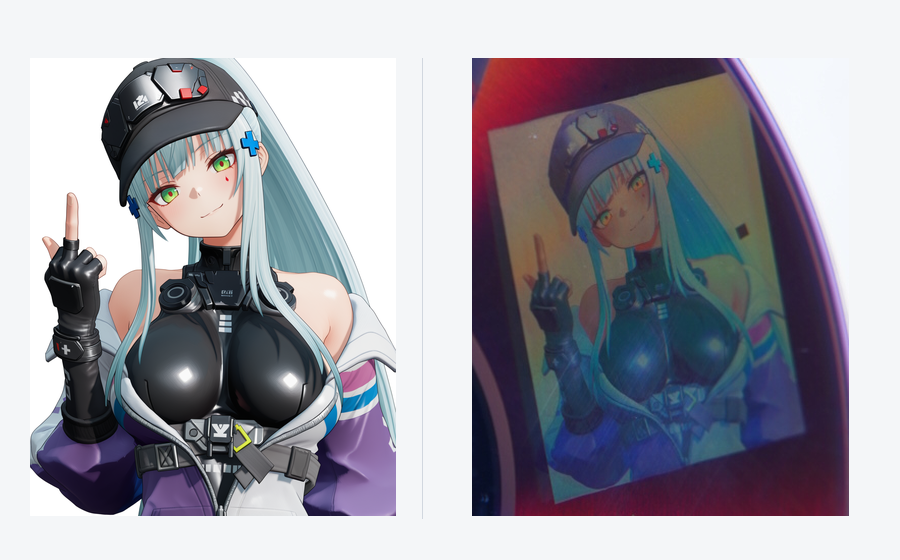</a><br>
</td>
<td width="50%" align="center">
<a href="docs/media/comparison-ak12.png">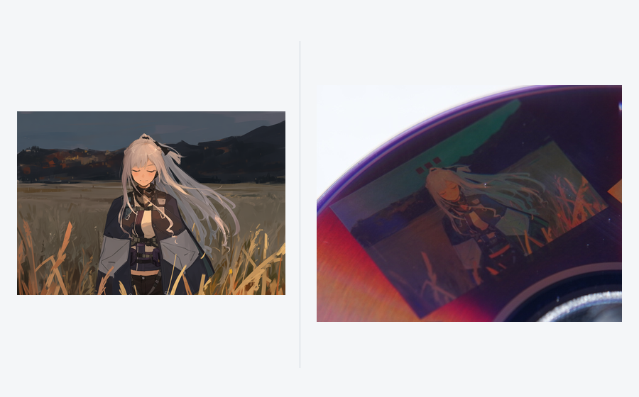</a><br>
</td>
</tr>
<tr>
<td width="50%" align="center">
<a href="docs/media/comparison-untitled.png">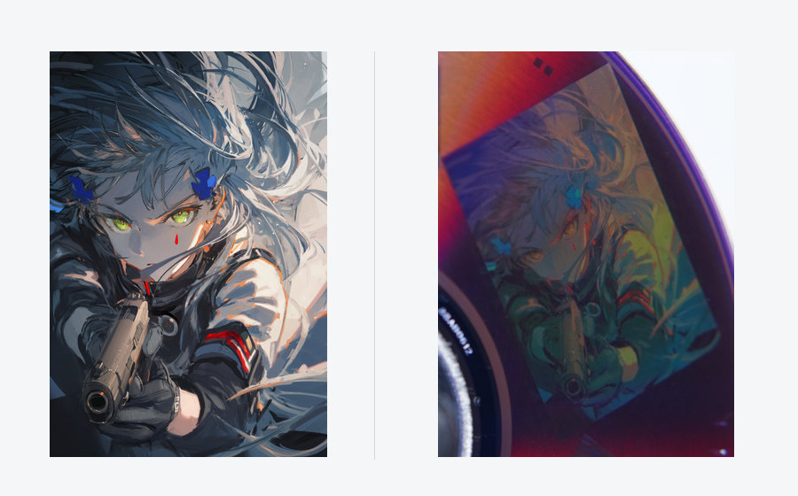</a><br>
</td>
<td width="50%" align="center">
<a href="docs/media/comparison-anna.png">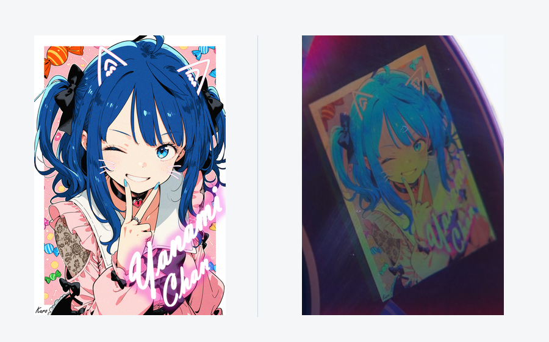</a><br>
</td>
</tr>
</table>

The disc close-ups have only been cropped, rotated, and resized. Color, exposure, and sharpness were left unchanged, and the photographs were checked against the appearance in person. The four examples show how different color ranges reproduce on the disc.

https://github.com/user-attachments/assets/d722f402-3078-4b46-9a33-03698969b643

**Viewing-angle demonstration.** [Alternative MP4 file](docs/media/viewing-angle.mp4) · [Download video](https://github.com/Neo-626/DiscColorStudio/raw/refs/heads/main/docs/media/viewing-angle.mp4)

The photographs show favorable viewing angles. Colors reproduce well within a very narrow range and shift as soon as the disc moves away from it. Keep expectations modest: finding the best view can take a few minutes of turning and tilting the disc. (From my experience: lay the disc on a table and sit facing it. Hold a white single-LED flashlight with its beam perpendicular to the tabletop, aimed at the disc's center hole. Slowly raise the flashlight vertically while watching the image on the right; its colors come into view at a certain height.)

The third-party illustrations used in these demonstrations are listed under [Illustration credits and rights](#illustration-credits-and-rights).

<details>
<summary>Show 4 full-disc photographs</summary>

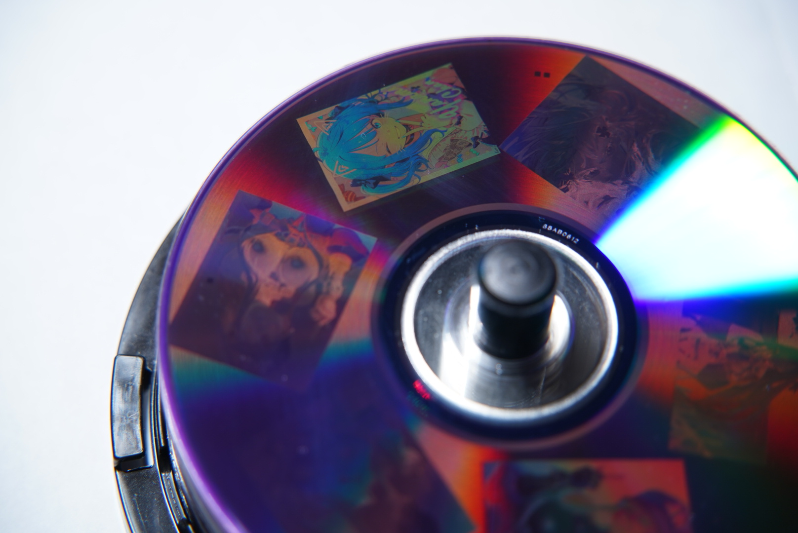
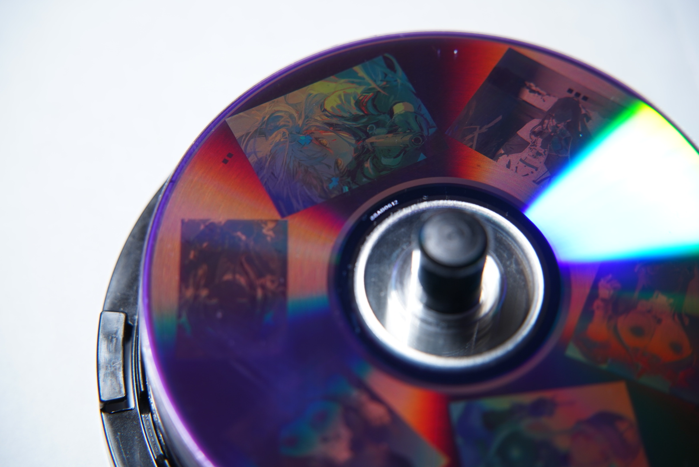
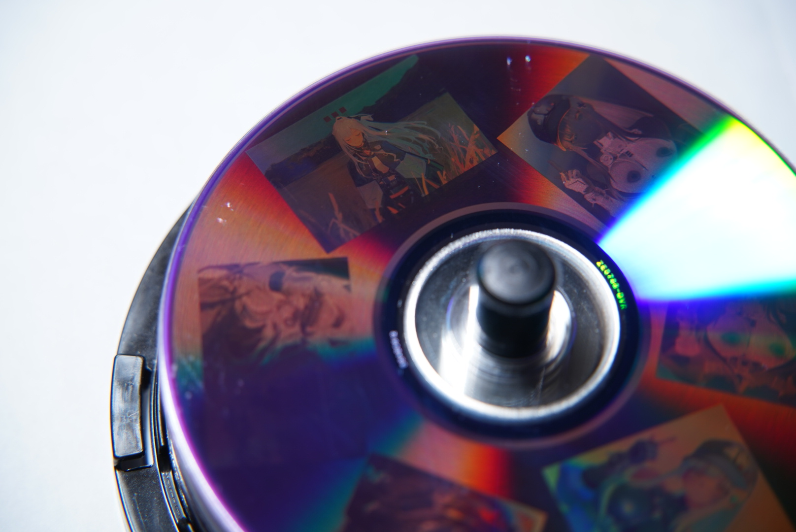
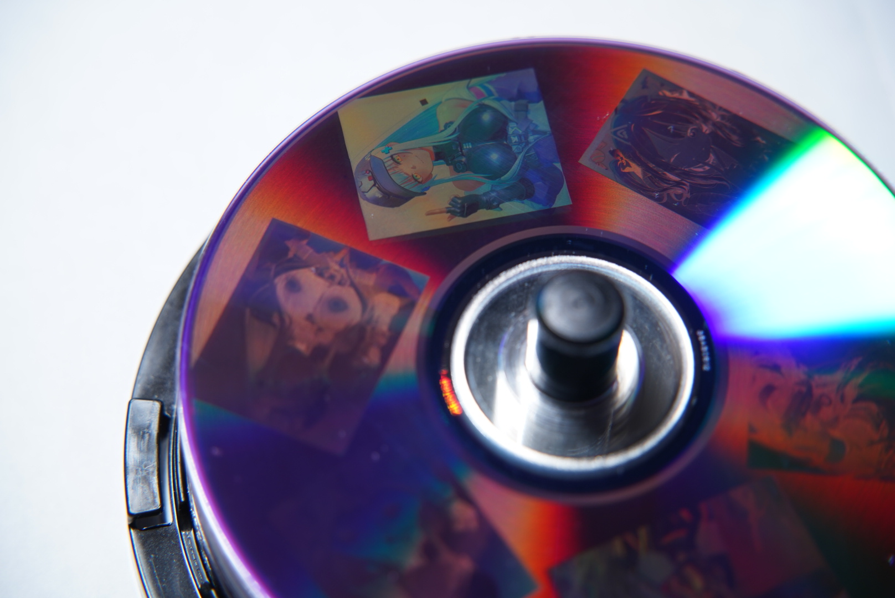

</details>

After downloading the repository, you can also open the [local demo page (Chinese)](docs/演示与原理.html) to watch the video and view the photographs and explanation together.

## How it works

A DVD-R has a recording layer containing dye that can be altered by the writing laser, with a reflective layer beneath it. During burning, the laser follows a preformed spiral track and creates a sequence of marks with different optical properties. The lengths, spacing, and arrangement of these marks carry data and also influence how the area reflects and diffracts light.

DIS uses a calibrated disc geometry model to map image positions to data positions along the spiral track. It compensates for sector scrambling so that the selected data textures reach the subsequent encoding stages. DVD's EFMPlus modulation converts bytes into channel codes, which the drive writes as marks and spaces. This project selects different repeating byte sequences within that pipeline to produce recording structures with different arrangements. Error-correction codes and synchronization information also contribute to the final recorded pattern.

When white light returns from neighboring microstructures, differences in optical path length cause constructive or destructive interference. Different wavelengths are reinforced in different directions, producing colors that change with viewing direction. The arrangement of the microstructures also affects diffraction efficiency: how much light at each wavelength reaches the observer.

**Selecting different recording textures changes the relative amounts of light from different wavelength bands reaching the same viewing direction. This produces different colors under fixed illumination and viewing directions.**

Under fixed illumination, an effective spectral-response model describes this process:

```math
I_t(\lambda)=H_t(\lambda;\theta_i,\theta_o,\phi)
```

Here, $`H_t`$ includes the fixed illumination and describes the effective spectral response of texture $`t`$ for illumination direction $`\theta_i`$, viewing direction $`\theta_o`$, and local track orientation $`\phi`$; $`I_t`$ is the spectrum reaching the viewing direction. The eye or camera weights different parts of this spectrum to form the perceived color. Rotating the disc changes the texture's orientation relative to the light and observer, changing $`H_t`$ and therefore its color. Track orientation also varies across the disc, so color mapping takes both texture and position into account.

In practice, we build an **empirical, angle-dependent color table** recording “texture ID + relative angle → photographed color.” For each target image color and disc position, the program selects suitable textures at that angle. It can approximate a target color by mixing several textures in fine spatial regions along neighboring tracks. At the viewing scale, the eye or camera averages the light from these regions. The program estimates the mixture as a weighted sum in linear RGB:

```math
\mathbf{C}_{\mathrm{mix}}(\phi)\approx\sum_j w_j\,\mathbf{C}_j(\phi),\qquad w_j\geq0,\quad\sum_j w_j=1
```

$`\mathbf{C}_j(\phi)`$ is the measured linear RGB of texture $`j`$ at that angle, and $`w_j`$ is its assigned proportion. Adjusting these proportions fills in intermediate colors and tonal levels between individual textures. Smooth transitions between neighboring angles' mixtures reduce bands caused by texture changes. Dark areas and outlines can also use DIS grayscale textures. The measured texture colors and their achievable mixtures form the available color gamut at each angle; the software approximates the image within that gamut.


> **Texture-search disc, shown for demonstration.** The dense patches were used to explore textures and colors. The generator, project, ISO, and original calibration photograph collection for this search disc **are not included in the repository or release packages**. The processed numerical color tables required by the application are included.

We burned many numbered candidate textures onto discs that had already undergone DIS geometry calibration. With the light and camera fixed, we rotated the disc in small increments and photographed it. Grid registration, color sampling, and manual verification established the relationship between texture, relative angle, and color. After comparing white candidates and available gamuts at different angles, we selected a continuous interval of roughly 60° in relative disc orientation with a richer range of colors as the basis for mapping and mixing.

I know this approach is rather crude. I also tried building a model to map textures to colors, but its accuracy kept hovering around 40%, so I am keeping the empirical table for now. If the model becomes more accurate, I may update the software to use it in place of the empirical table.

## Tested media and sharing results

The disc demonstrations and built-in color table use **US-market Verbatim 95058 DVD-R discs, rated at 16× and burned at 4×**.

Other brands and models have not yet been tested. In principle, the same texture-based color technique and empirical mapping approach should work with other DVD-R media supported by DIS.

If you try other discs, please share your results in an [Issue](https://github.com/Neo-626/DiscColorStudio/issues/new). Include the disc brand and model, drive and writing speed, lighting conditions, and photographs or a video of the disc being rotated.

<a id="功能与使用"></a>

## Usage guide

Follow these eight steps to make a color disc. Red boxes highlight the controls; click a screenshot to enlarge it.

### 1. Download the application and prepare the discs and drive

1. Open the latest version under [Releases](https://github.com/Neo-626/DiscColorStudio/releases). In **Assets**, download the Windows portable package whose name contains `win-x64.zip`.
2. Extract the entire archive into a folder and run **`DiscColorStudio.exe`**. Keep the accompanying `data`, `guide`, and other application files in place.
3. At startup, select **English** and click **Continue / 继续**. The application remembers your choice; switch languages through **Help → Language…**.
4. Prepare a DVD-R writer, discs for calibration, and a **new blank single-layer DVD-R** for your final design. Use the same disc model for calibration and the final burn.

Have a white LED lamp ready for viewing the finished disc.

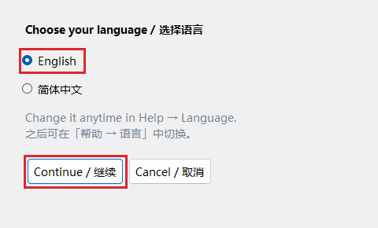

### 2. Calibrate the disc geometry in DIS and import the saved project

**Geometry calibration** determines which data position on the disc corresponds to each image position. Complete this step in [DiscImageStudio (DIS)](https://github.com/JiaFeiMiao-K-Cat/DiscImageStudio) first.

1. Follow the [DIS v1.4.0 calibration tutorial (Chinese)](https://github.com/JiaFeiMiao-K-Cat/DiscImageStudio/blob/3a5cde635c182d6a7e01ff99c2cc1be2ac3ab668/docs/CALIBRATION_TUTORIAL.md): establish the initial geometry, then perform boundary and fine calibration.
2. Apply the final calibration parameters to a **DVD drawing project** in DIS and press **Ctrl+S**. This saves a **`.discproj`** file, such as `MyDVDCalibration.discproj`. The default folder is **Documents → DiscImageStudio Projects**.
3. Start Disc Color Studio. In the startup dialog below, click **Select DIS calibration project** and choose the file you just saved.
4. Review the imported disc parameters, check the confirmation box to confirm that the project contains your final calibration, and click **Apply calibration and start designing**.

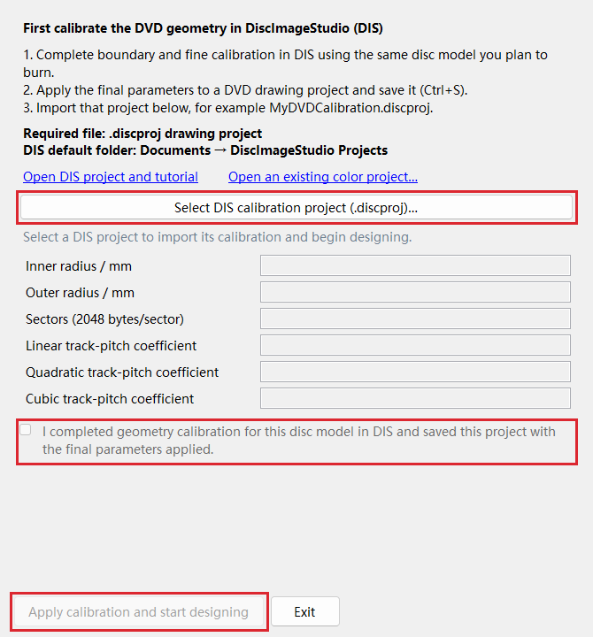

The program reads the **inner radius, outer radius, sector count, and three track-pitch coefficients** automatically. The radii define the writable ring, the sector count determines data capacity, and the coefficients describe how the spiral track's position varies across the disc.

Calibration is saved with your color project. On later launches, choose **Open an existing color project** to continue. When switching disc models, use **DIS calibration** in the main toolbar to import the corresponding project.

### 3. Import and arrange images on the disc

1. Click **Import images** at the top left and select one or more images, or drag image files into the window.
2. Click an image on the canvas or in the layer list on the left. A blue border identifies the selected image; the right sidebar edits this image.
3. Drag the image to move it, drag its corners to resize it, and drag the round handle above it to rotate it. Place the content you want to keep within the burgundy writable ring.
4. Expand **Layout** in the right sidebar to enter physical dimensions. A width of `28`, for example, means **28 mm** on the disc. Keep **Maintain aspect ratio** checked to preserve the image's proportions.

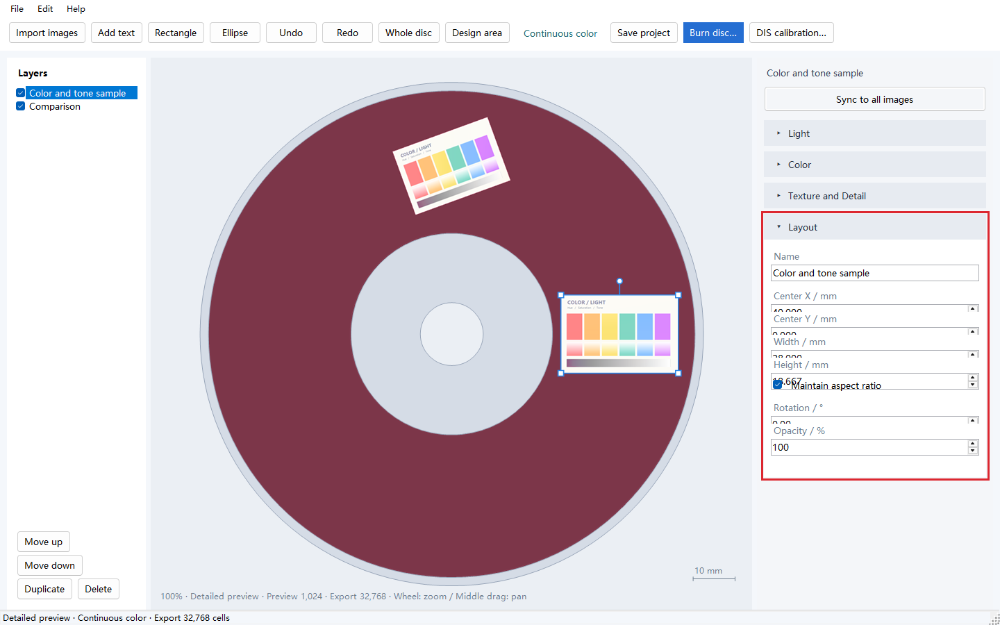

| Control | How to use it |
| --- | --- |
| Center X / Y | Coordinates in mm, measured from the disc center. Positive X points right; positive Y points down. Enter values for precise alignment. |
| Width / Height / Rotation | Set physical dimensions and orientation. Hold Shift while dragging the rotation handle to rotate in 15° increments. |
| Opacity | Defaults to 100%. Lower values blend the image with underlying layers or the disc background. |
| Move up / down | Change the stacking order. Layer checkboxes toggle visibility, and Duplicate creates a comparison copy. |
| Add text / Rectangle / Ellipse | Add these from the toolbar, then select them to edit their content, dimensions, and fill color in Layout. |
| Whole disc / Design area | Change the viewing area. Use the mouse wheel to zoom and drag with the middle mouse button to pan. |

**Continuous color** automatically selects a viewing direction and texture mixture based on image content and position. The canvas predicts each image at its own suitable viewing orientation. Rotate the physical disc to view the images in turn.

### 4. Adjust overall brightness in Light

Select an image, expand **Light**, and drag a slider or enter a value to adjust its tones.

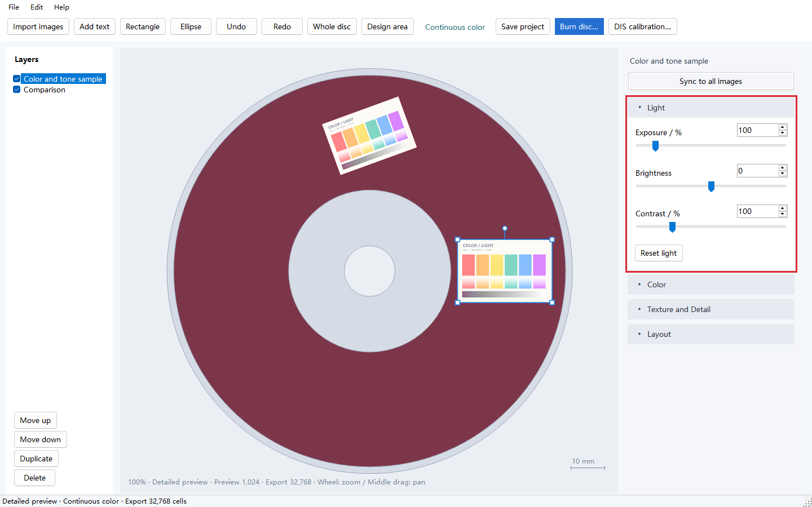

| Setting | What it does | Starting point and adjustment |
| --- | --- | --- |
| Exposure | Multiplies the input image signal; 100% retains its original level. | Default: **100%**. If the whole image is dark, try **110%–130%**, watching detail in faces, white backgrounds, and highlights. |
| Brightness | Adds to or subtracts from brightness values across the image. | Default: **0**. Try **+5 to +10** for a small lift, or negative values to darken it. |
| Contrast | Changes the difference between light and dark tones. | Default: **100%**. Try **110%–120%** if the image looks flat, or around **90%** to compare how highlight and shadow detail is retained. |

**Reset light** restores exposure to 100%, brightness to 0, and contrast to 100%.

### 5. Adjust overall and individual colors in Color

**HSL** stands for **Hue, Saturation, and Lightness**. **All colors** adjusts the entire selected image. The eight color buttons select hue ranges in the input image, making it easier to adjust clothing, hair, and other areas separately.

1. Expand **Color** and leave **Enable color adjustments** checked.
2. Start with **All colors**, selected by default. Adjust the three sliders to change the whole image.
3. To refine a particular color, select **Red, Orange, Yellow, Green, Cyan, Blue, Purple, or Magenta**. For purple clothing, start with Purple; pinkish-purple areas may also respond to Magenta.
4. Switch back to **All colors** to continue the overall adjustment. Both sets of settings are retained and combined.

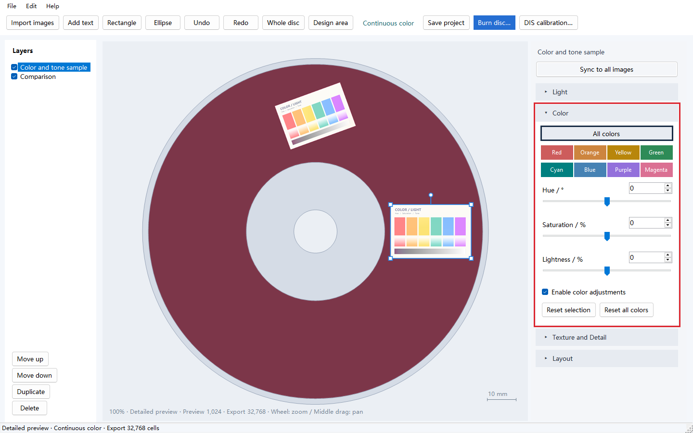

| Setting | What it does and how to choose |
| --- | --- |
| Hue | Rotates colors. Range: **−180° to +180°** for All colors, **−60° to +60°** for an individual range. Default: **0°**. Start with changes of **5°–10°**. |
| Saturation | Controls vividness, from **−100 to +100**; default **0**. Try **+10 to +20** for muted colors. In All colors, **−100** makes the image grayscale; neutral grays stay neutral as saturation increases. |
| Lightness | Makes colors lighter or darker, from **−100 to +100**; default **0**. Start with increments of **5–10**. All colors also adjusts black, white, and gray areas. |

Individual hue adjustments are applied first, followed by All colors. Uncheck **Enable color adjustments** to compare before and after. **Reset selection** resets the currently selected All colors or hue range; **Reset all colors** resets both the overall adjustment and all eight ranges.

### 6. Choose mixing and sampling settings in Texture and Detail

A **texture** is a fine, repeating data pattern written to the DVD. The program selects and mixes textures using the measured color table to form the image's colors and tones.

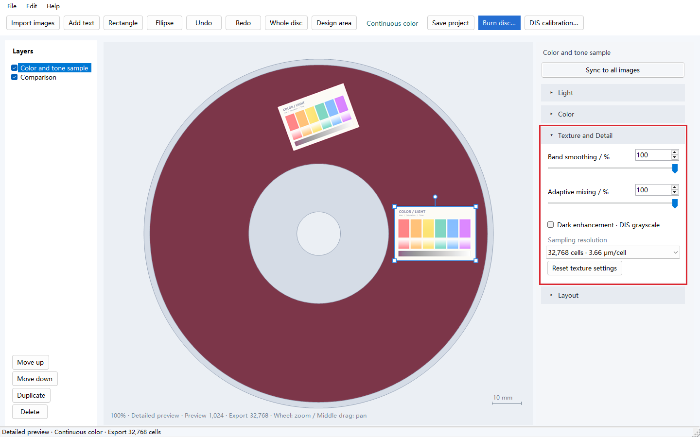

| Setting | What it does | How to choose |
| --- | --- | --- |
| Band smoothing | Smooths transitions between texture mixtures at neighboring disc angles, reducing stripe-like color boundaries. | **Start at 100%**. To compare transition strength, duplicate an image and set the copy to 50%. |
| Adaptive mixing | Distributes several related textures across fine regions to approximate intermediate colors and gradients. | **Start at 100%**. Try 50% on a copy to compare a less mixed result, looking at skin tones, gradients, and outlines. |
| Dark enhancement · DIS grayscale | Adds DIS grayscale textures in dark, low-saturation areas to strengthen black clothing, shadows, and dark outlines. | Off by default. Enable it if dark areas look too bright or too colorful, then check their remaining detail. |
| Sampling resolution | Controls the spatial density at which the source image is sampled during ISO generation. | Start at **32,768** for general images; compare **65,536** for fine lines and small text. |

**Choosing a sampling resolution:**

| Setting | Software sampling interval | Suggested use |
| --- | --- | --- |
| 32,768 | About 3.66 μm per cell | A starting point for general image work. |
| 65,536 | About 1.83 μm per cell | Further comparison for fine hair, small text, and detailed outlines. |
| 131,072 / 262,144 | About 0.92 / 0.46 μm per cell | High-density sampling experiments; additional visible detail has not been measured, and ISO generation takes longer. |

The grid count divides the 120 mm canvas width into that many sample positions. The **Preview** value at the bottom of the window is used for interactive display; **Export** is used to generate the ISO.

The current encoder samples the source image at the centers of controllable data bytes, normally spaced about **2.13 μm along the track** (16 × 0.1333 μm); synchronization and error-correction regions create larger gaps between some sample positions. Adjacent tracks have a nominal spacing of about **0.74 μm**. A finer software grid can reduce edge-position and sampling errors; its benefit depends on the image, texture, and geometry calibration. **0.46 μm is the software sampling interval. The effective resolution of the image on the disc has yet to be measured.** [Encoder implementation](https://github.com/Neo-626/DiscColorStudio/blob/main/third_party/DiscImageStudio/DvdImageSolver/Solver/FastDispersionImageWriter.cs)

### 7. Compare settings, sync adjustments, and save the project

1. To compare settings on one disc, select an image, click **Duplicate** on the left (or press **Ctrl+D**), move the copy elsewhere, and adjust it independently.
2. Once you have a set of adjustments you like, click **Sync to all images** at the top of the right sidebar. The selected image's Light, overall and eight-range HSL, texture, and sampling settings are applied to all images and become the defaults for later imports. Each image retains its position, size, rotation, and opacity.
3. Click **Save project** (or press **Ctrl+S**) to save a **`.discolor`** file. It includes image assets, layer layout, adjustments, and the imported DIS geometry calibration.

Use **Ctrl+Z / Ctrl+Y** for **Undo / Redo**. A sync operation can also be undone as a single step.

### 8. Generate and burn the ISO, then view the disc

1. Insert a new blank single-layer DVD-R and click **Burn disc** in the toolbar.
2. Select the writer in the drive list. After inserting a disc, use **Refresh drives** to update the media information.
3. Choose one of the speeds offered by the drive. For the tested Verbatim 95058 media, **4×** is a useful starting point. Use the same speed for your calibration and final burns to help reproduce the result.
4. Click **Choose** to set the ISO path, for example `D:\DiscColorStudio\my-design.iso`. Allow about **5 GB** of free disk space for a single-layer DVD image.
5. Click **Burn disc**. The program generates the ISO, writes it to the disc, and displays the result. To save the image first, click **Generate ISO** instead.

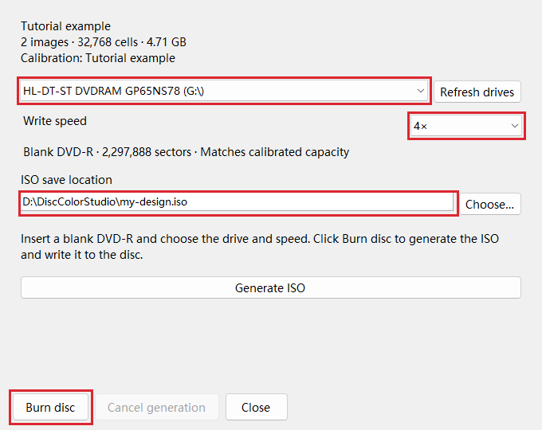

Remove the finished disc and face its data side toward a white LED lamp and the observer. Keep the lamp and your viewing position fixed, then slowly rotate and slightly tilt the disc to find a favorable orientation for each image. The video above demonstrates this process.

**What the three file types are for:**

| File | Source and purpose |
| --- | --- |
| `.discproj` | A DVD drawing project saved by DIS. Import its geometry calibration when starting a design here. |
| `.discolor` | A color design project saved by this application. Reopen it to continue arranging and adjusting images. |
| `.iso` | The generated DVD data image, ready to be written to a disc. |

Open **Help → User guide**, or open **UserGuide.html** (English) or **使用说明.html** (Chinese) from the portable package.

## Vibe coding

This project was created entirely by AI.

## Build from source

Requires Windows x64 and the .NET 10 SDK.

```powershell
dotnet publish src/DiscColorStudio/DiscColorStudio.csproj -c Release -r win-x64 --self-contained true -o publish
```

The required color tables are included in the source.

## Illustration credits and rights

The disc photographs and video use the following works as image content. Thank you to their creators. Image numbers below start at 1.

| Work | Artist / uploader | Image used in the demonstration |
| --- | --- | --- |
| [GF2 Klukai](https://www.pixiv.net/artworks/134992243) | [gcmsfromisland](https://www.pixiv.net/users/112251818) | Image 2 (p1) |
| [AK-12](https://www.pixiv.net/artworks/133822252) | [BatonKhleba](https://www.pixiv.net/users/118918672) | Image 1 (p0) |
| [HK416](https://www.pixiv.net/artworks/131999367) | [momostima](https://www.pixiv.net/users/89801761) | Only image (p0) |
| [八奈見杏菜『地雷系美少女 八奈见酱』](https://www.pixiv.net/artworks/124941070) | [黑木kuro](https://www.pixiv.net/users/29258872) | Image 1 (p0) |

These illustrations demonstrate DVD-R burning and the resulting disc colors. Rights to the illustrations and characters belong to their respective rights holders.

**Rights-holder contact and removal:** If a rights holder believes that a demonstration photograph, video, or other material infringes their rights, please contact us through a [project Issue](https://github.com/Neo-626/DiscColorStudio/issues/new), including a link to the original work and the location of the material concerned. We will promptly review and remove the relevant material.

## License and attribution

The application code is licensed under GNU GPL v3; see [LICENSE](LICENSE). Upstream versions, modifications, and third-party licenses are listed in [THIRD-PARTY-NOTICES.html (Chinese)](THIRD-PARTY-NOTICES.html). Distributions of the application include the corresponding source and licenses.

The illustrations and characters in the demonstration photographs and video belong to their respective rights holders.
