# Disc Color Studio

[English](README.md) | **简体中文**

在普通 **DVD-R 数据面**上刻录彩色图案的 Windows 工具。基于 [DiscImageStudio（DIS）](https://github.com/JiaFeiMiao-K-Cat/DiscImageStudio) 的 DVD 编码与刻录组件，增加实测角度色表、彩色映射、纹理混合和图层编辑。

**软件仅支持新的空白单层 DVD-R（4.7 GB）。**

## 实盘演示

四幅插画的原图与实盘局部对照。

<table>
<tr>
<td width="50%" align="center">
<a href="docs/media/comparison-klukai.png">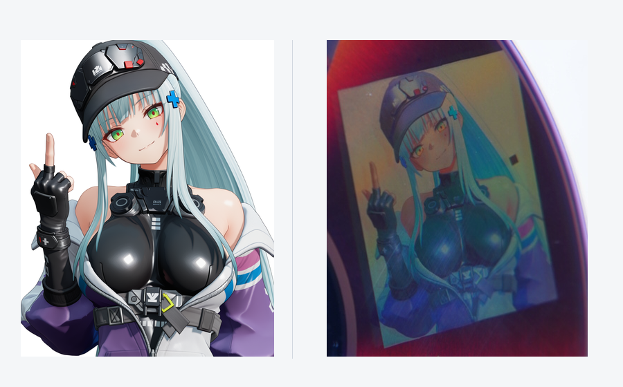</a><br>
</td>
<td width="50%" align="center">
<a href="docs/media/comparison-ak12.png">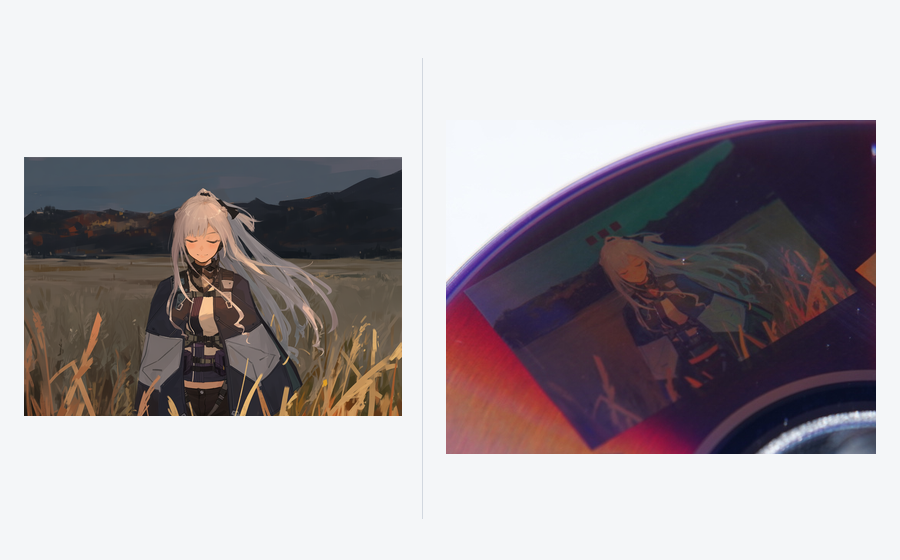</a><br>
</td>
</tr>
<tr>
<td width="50%" align="center">
<a href="docs/media/comparison-untitled.png">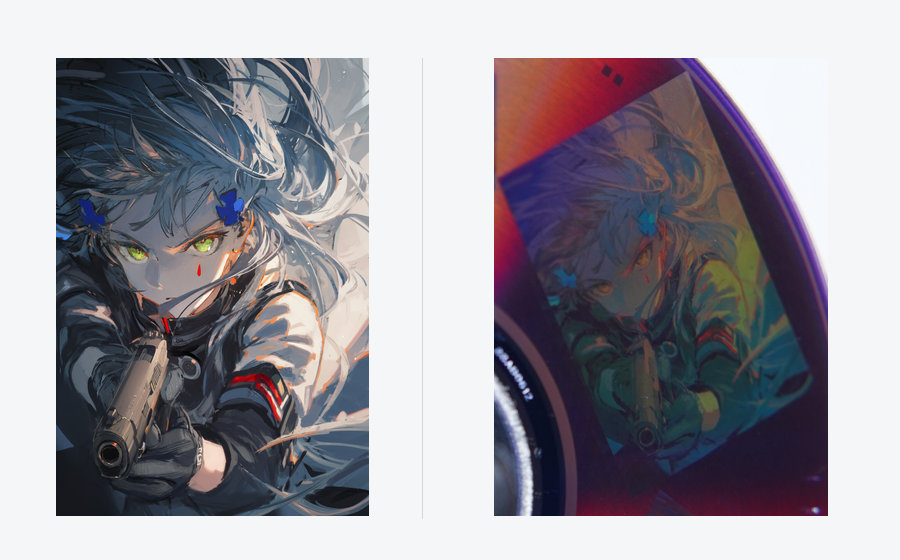</a><br>
</td>
<td width="50%" align="center">
<a href="docs/media/comparison-anna.png">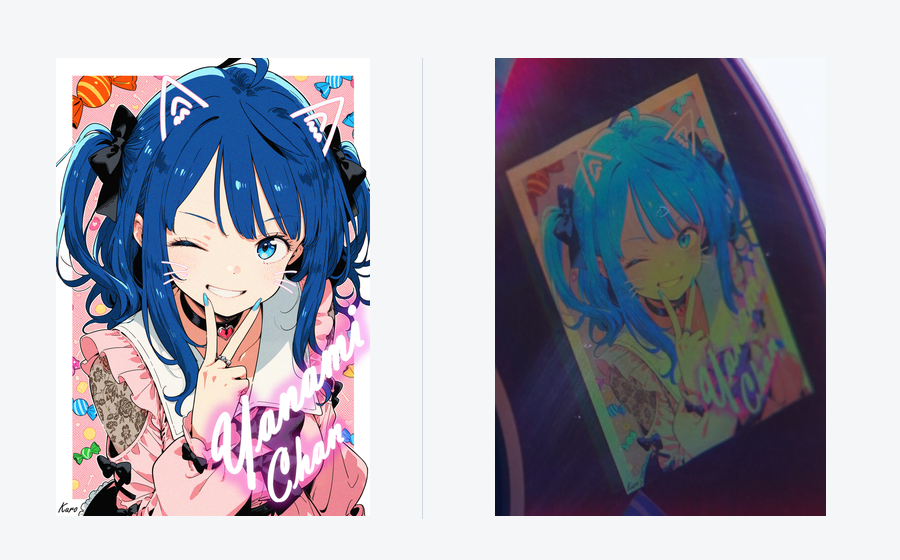</a><br>
</td>
</tr>
</table>

实盘局部仅裁剪、旋转方向和缩放，未调整颜色、曝光或锐度，并确认视觉效果和图片一致。四组照片呈现了不同色域下的色彩表现。

https://github.com/user-attachments/assets/d722f402-3078-4b46-9a33-03698969b643

**角度演示。** [备用 MP4 文件](docs/media/viewing-angle.mp4) · [下载视频](https://github.com/Neo-626/DiscColorStudio/raw/refs/heads/main/docs/media/viewing-angle.mp4)

照片展示较合适角度下的效果；可以看到，图片颜色仅在很窄的范围内可以在碟片上还原，稍微偏离颜色较准的角度就会偏色。所以不要对这个项目抱太大期望，通常你需要花几分钟摆弄光盘来找到最佳观测角度。（个人经验：盘摆在桌子上，正对盘做好。拿个白光单led手电，光束垂直桌面，指向光盘中心圆孔，然后缓慢竖直上移，观察右侧的图案，在某个高度色彩就会复原）

演示中的第三方插画见下方[作者、原作链接与权利声明](#演示插画来源与声明)。

<details>
<summary>展开 4 张完整实盘照片</summary>

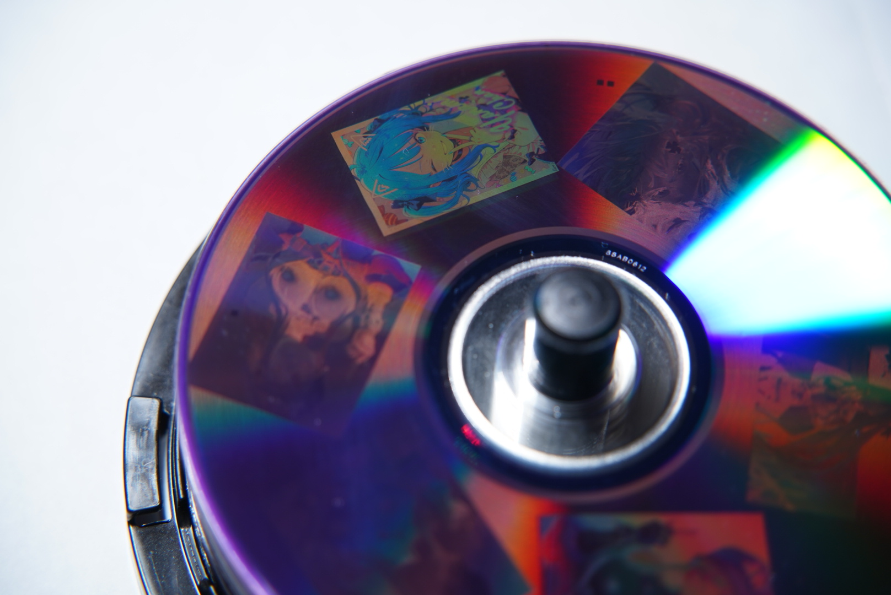
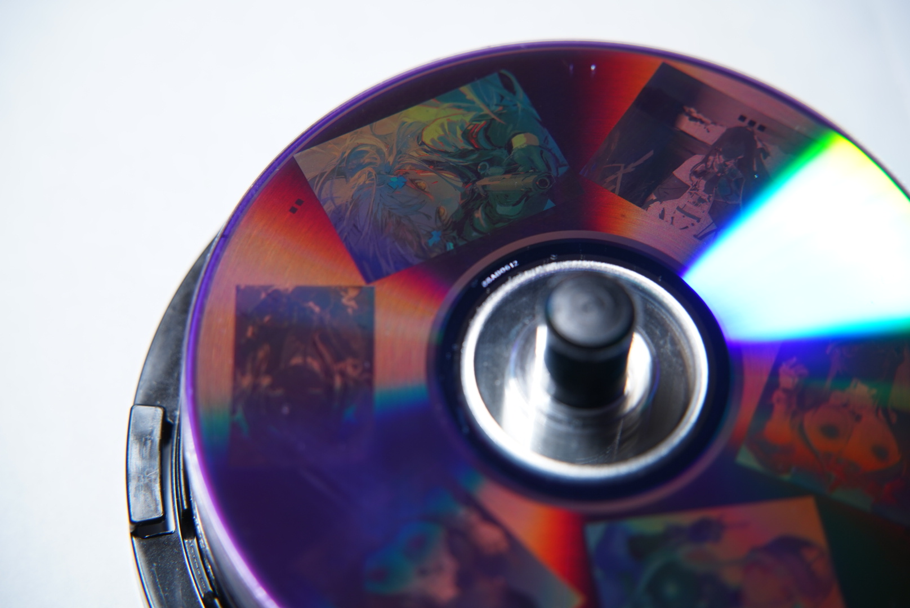
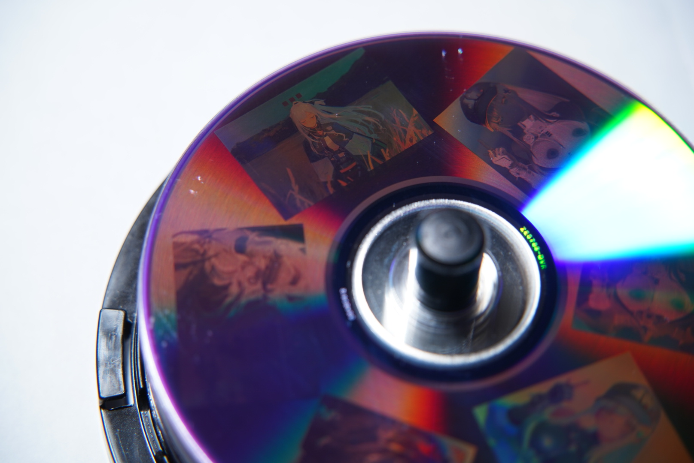
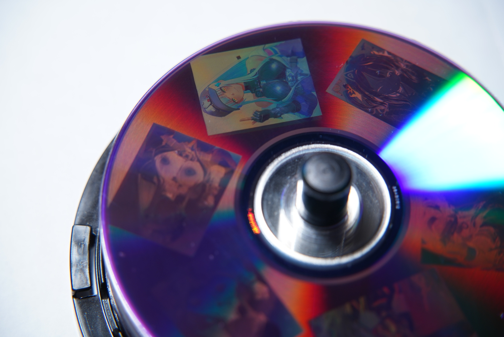

</details>

下载仓库后也可打开 [本地演示页](docs/演示与原理.html)，在同一页面播放视频、查看照片和原理说明。

<details>
## 原理

DVD-R 的记录层包含可被刻录激光改变的染料，下面配有反射层。刻录时，激光沿预制的螺旋轨道形成一连串光学性质不同的记录标记。标记的长度、间隔和排列既承载数据，也参与决定这个区域如何反射和衍射光线。

DIS 使用校准后的光盘几何模型，将图像位置映射到螺旋轨道上的数据位置，并通过补偿扇区扰码，将选定的数据纹理送入后续编码。DVD 的 EFMPlus 调制把字节转换为通道码，再由刻录机写成相应的标记与间隔。本项目在这条流程中选择不同的重复字节序列，生成具有不同排列特征的记录结构；纠错码与同步信息也共同构成最终写入的图样。

白光从相邻微结构返回时，光程差会使同一波长的光发生相长或相消干涉；不同波长满足增强条件的方向各不相同，因此盘片会出现随方向变化的彩色。微结构的排列还会影响各个波长在不同方向上的衍射效率，也就是有多少光进入观察者眼中。

**通过选择不同的记录纹理，改变各波段光进入同一观察方向的相对强度，就能在入射方向和观察方向固定时得到不同颜色。**

在固定照明下，这个过程可用有效光谱响应模型描述：

```math
I_t(\lambda)=H_t(\lambda;\theta_i,\theta_o,\phi)
```

其中，$`H_t`$ 是包含固定照明影响的纹理 $`t`$ 在指定入射方向 $`\theta_i`$、观察方向 $`\theta_o`$ 和局部轨道方位 $`\phi`$ 下的有效光谱响应，$`I_t`$ 是进入观察方向的光谱。人眼或相机对这个光谱的不同波段作加权响应，形成所见颜色。同一纹理随盘片转动而变色，是因为它相对光源和观察方向的方位改变，进而改变了 $`H_t`$。盘面不同位置的轨道方向也不同，因此颜色映射需要同时考虑纹理和位置。

在实际操作中，**构建了一个特定角度下的经验色表**：记录“纹理编号 + 相对角度 → 拍到的颜色”，再根据图片目标颜色和盘面位置，选择该角度下合适的纹理。一个目标颜色可以由多种纹理按比例混合：软件把它们分配到相邻轨道上的细密区域，人眼或相机在观察尺度上对这些区域的光进行平均。程序在线性 RGB 空间中用加权和估算混色：

```math
\mathbf{C}_{\mathrm{mix}}(\phi)\approx\sum_j w_j\,\mathbf{C}_j(\phi),\qquad w_j\geq0,\quad\sum_j w_j=1
```

$`\mathbf{C}_j(\phi)`$ 是该角度下第 $`j`$ 种纹理的实测线性 RGB，$`w_j`$ 是分配给它的比例。调节这些比例可以补充单一纹理之间的中间色与明暗层次；让相邻角度的配方连续过渡，可以减轻纹理切换形成的条带。深色和轮廓可结合 DIS 灰阶纹理处理。各纹理的实测颜色及其可实现的混色共同构成该角度的可用色域，软件在这个范围内逼近图片的目标颜色。


> **搜索盘实拍，仅供演示。** 图中的密集色块用于搜索纹理和颜色。此搜索盘的生成工具、工程、ISO 及原始校准照片集**不包含在仓库或发行包中**。软件运行所需的处理后数值色表仍随程序提供。

我们在完成 DIS 几何校准的盘片上，刻录大量带编号的候选纹理；固定灯光和相机，逐步旋转盘片拍摄，再通过网格配准、取色和人工核对，建立“纹理、相对角度与颜色”的对应关系。比较各角度的白色候选和可用色域后，选取颜色较丰富的连续约 60° 区间，作为软件配色与纹理混合的依据。

我知道这个方法有些蠢。我也尝试构建模型来构建纹理到颜色的映射，但是始终准确率停留在40%上下，所以暂时不采用。也许之后模型准确率上来了，我会更新这个软件替换掉经验色表。

## 测试盘片与结果分享

实盘演示与内置色表使用的是**美国版威宝（Verbatim）95058 DVD-R，标称 16×，实际以 4× 刻录**。

其他品牌、型号的盘片尚未测试。从原理上看，这种纹理显色与实测配色方法也应能用于其他兼容 DIS 的 DVD-R。

欢迎测试过其他盘片的朋友通过 [Issue](https://github.com/Neo-626/DiscColorStudio/issues/new) 分享结果，包括盘片品牌和型号、光驱及刻录速度、光照条件，以及实拍照片或转动视频。

## 功能与使用

按以下八步制作彩色光盘。截图中的红框标出对应控件，点击图片可放大。

### 1. 下载程序，准备盘片与光驱

1. 从 [Releases](https://github.com/Neo-626/DiscColorStudio/releases) 打开最新版本，在 **Assets** 中下载名称含 `win-x64.zip` 的 Windows 便携包。
2. 将压缩包完整解压到一个文件夹，运行其中的 **`DiscColorStudio.exe`**。保留旁边的 `data`、`guide` 和其他程序文件。
3. 启动时选择 **简体中文**，点击 **Continue / 继续**。程序记住上次选择；编辑时也可通过 **帮助 → 语言…** 即时切换。
4. 准备支持 DVD-R 刻录的光驱、用于校准的盘片，以及一张用于正式设计的**新空白单层 DVD-R**。校准与正式刻录使用同型号盘片。

准备一盏白光 LED 灯，供完成后观察效果。

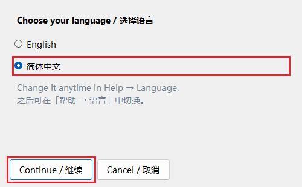

### 2. 在 DIS 完成几何校准，导入保存好的工程

**几何校准**用于确定光盘上“哪个数据位置对应哪个图像位置”。请先用 [DiscImageStudio（DIS）](https://github.com/JiaFeiMiao-K-Cat/DiscImageStudio) 完成这一步。

1. 按 [DIS v1.4.0 校准教程](https://github.com/JiaFeiMiao-K-Cat/DiscImageStudio/blob/3a5cde635c182d6a7e01ff99c2cc1be2ac3ab668/docs/CALIBRATION_TUTORIAL.md) 完成盘片标定：先确定初始几何参数，再进行边界与精确标定。
2. 将最终标定参数应用到 DIS 的 **DVD 绘图工程**，按 **Ctrl+S** 保存，得到扩展名为 **`.discproj`** 的文件，例如 `我的DVD校准.discproj`。默认位置是 **文档 → DiscImageStudio Projects**。
3. 启动 Disc Color Studio，在下面的引导窗口点击 **选择 DIS 校准工程（.discproj）…**，选中刚保存的文件。
4. 程序会显示读取到的盘面参数。确认这个工程已应用最终标定结果，勾选确认框，再点 **应用校准并开始设计**。

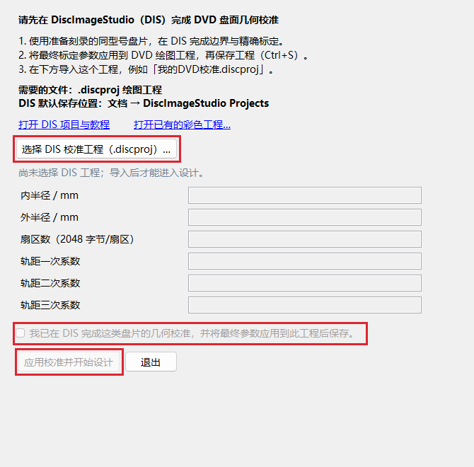

程序会自动读取**内半径、外半径、扇区数和三项轨距系数**：前两项确定绘图环带，扇区数决定写入的数据容量，轨距系数描述螺旋轨道的位置变化。

校准结果会随彩色工程保存。以后启动时点 **打开已有的彩色工程…** 继续编辑；更换盘片型号时，点主界面顶部的 **DIS 校准…** 导入对应工程。

### 3. 导入图片，摆放到盘面上

1. 点击左上角 **导入图片**，选择一张或多张图片；也可以把图片拖进窗口。
2. 在画布上或左侧图层列表中点击图片。出现蓝色边框后，右侧面板调整的就是这张图片。
3. 拖动图片移动位置，拖动四角缩放，拖动图片上方的圆形手柄旋转。把需要保留的内容放在盘面酒红色的可写环带内。
4. 点击右侧 **布局** 标题展开面板，填写实际尺寸；例如宽度填 `28`，表示在盘上占 **28 mm**。保持 **保持宽高比** 勾选，可按原比例缩放。

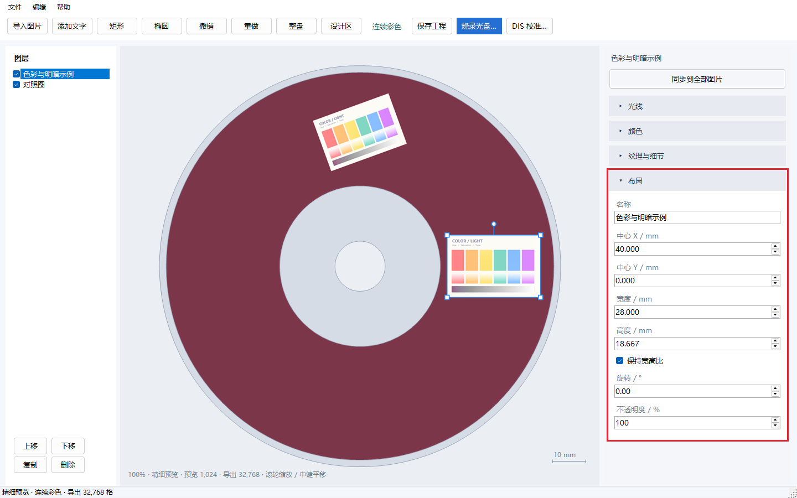

| 控件 | 怎么使用 |
| --- | --- |
| 中心 X / Y | 以盘心为原点，单位为 mm；X 向右为正，Y 向下为正。需要对齐时直接填写数值。 |
| 宽度 / 高度、旋转 | 设置成品尺寸和方向。按住 Shift 拖动旋转柄，可按 15° 调整。 |
| 不透明度 | 默认 100%；减小后，图片会与下方图层或盘面背景混合。 |
| 左侧上移 / 下移 | 改变图层叠放顺序。勾选框控制图层显示，复制按钮可建立另一份对照。 |
| 添加文字、矩形、椭圆 | 在顶部工具栏添加，选中后在「布局」中编辑内容、尺寸与填充颜色。 |
| 整盘 / 设计区 | 切换查看范围；滚轮缩放画布，按住鼠标中键拖动平移。 |

**连续彩色**会自动根据图片内容和盘面位置选择观看方向与纹理配方。画布展示各张图片分别处于适合观看方向时的预测效果；实盘上通过转动盘片依次观看。

### 4. 在「光线」中调整整体明暗

选中图片，展开 **光线**，拖动滑块或输入数值调整明暗。

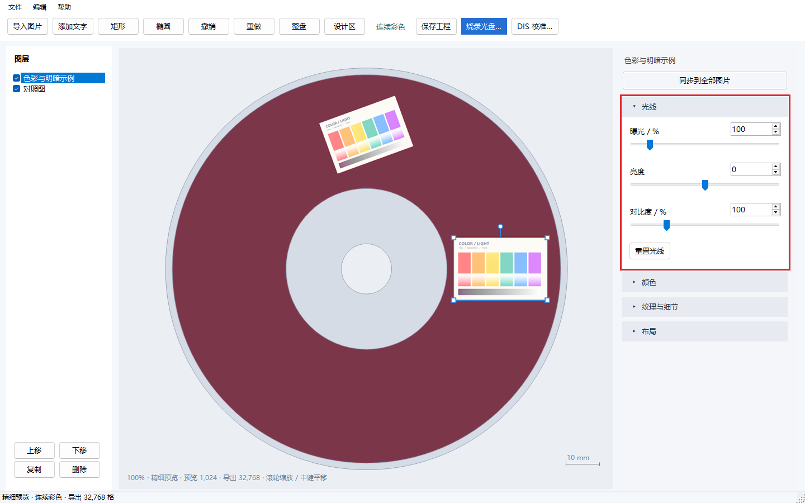

| 参数 | 作用 | 起步设置与调整方法 |
| --- | --- | --- |
| 曝光 | 按比例放大或减小输入图像信号，100% 保持原值。 | 默认 **100%**。整体偏暗时，可从 **110%～130%** 试起；边调边看脸部、白底和高光的层次。 |
| 亮度 | 整体增加或减少亮度值。 | 默认 **0**。小幅提亮可试 **+5～+10**，需要压暗则向负值调。 |
| 对比度 | 调整亮部与暗部的差距。 | 默认 **100%**。画面发灰可试 **110%～120%**；想保留更多高光和暗部层次，可降到 **90%** 附近比较。 |

点击 **重置光线** 可恢复曝光 100%、亮度 0、对比度 100%。

### 5. 在「颜色」中调整整体和指定颜色

**HSL** 分别是 **色相（Hue）、饱和度（Saturation）、明亮度（Lightness）**。**全部颜色** 同时调整选中图片的所有颜色。八个颜色按钮按输入图片的色相划分区域，方便单独调整衣服、头发等颜色。

1. 展开 **颜色**，保持 **启用颜色调整** 勾选。
2. 默认选中 **全部颜色**，拖动三个滑块，调整整张图片的色相、饱和度和明亮度。
3. 需要细调某类颜色时，点击对应按钮。例如紫色衣服先选 **紫**，偏粉紫的部分也可以调整 **洋红**。
4. 再点 **全部颜色** 可继续整体调整。整体与各色通道的数值分别保留，并共同生效。

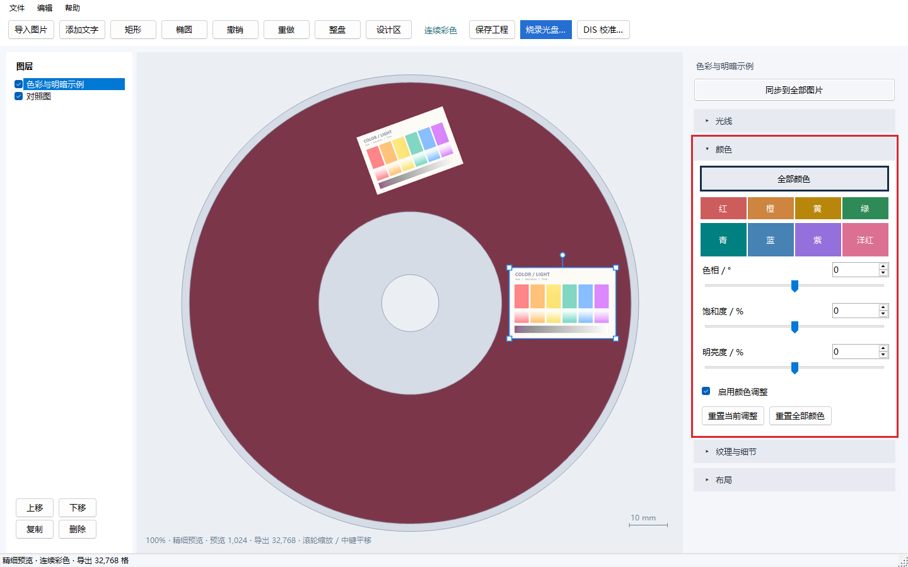

| 参数 | 作用与选择方法 |
| --- | --- |
| 色相 | 改变颜色倾向。「全部颜色」范围为 **−180°～+180°**，单个色彩通道为 **−60°～+60°**。默认 **0°**，先以 **5°～10°** 小幅调整。 |
| 饱和度 | 控制鲜艳程度，范围 **−100～+100**，默认 **0**。颜色较淡可从 **+10～+20** 试起。「全部颜色」调到 **−100** 时整图变为灰阶；增加饱和度时，中性灰保持中性。 |
| 明亮度 | 让颜色变亮或变暗，范围 **−100～+100**，默认 **0**，先以 **5～10** 为步长调整。「全部颜色」也会调整黑白灰区域。 |

程序先应用各色通道调整，再应用「全部颜色」调整。取消 **启用颜色调整** 可对照调整前后；**重置当前调整** 只复位当前选中的「全部颜色」或色彩通道，**重置全部颜色** 同时复位整体调整和八个通道。

### 6. 在「纹理与细节」中选择混色与精度

**纹理**是写入 DVD 的细密重复数据图样。程序根据实测色表选择和混合纹理，形成图片的颜色与明暗。

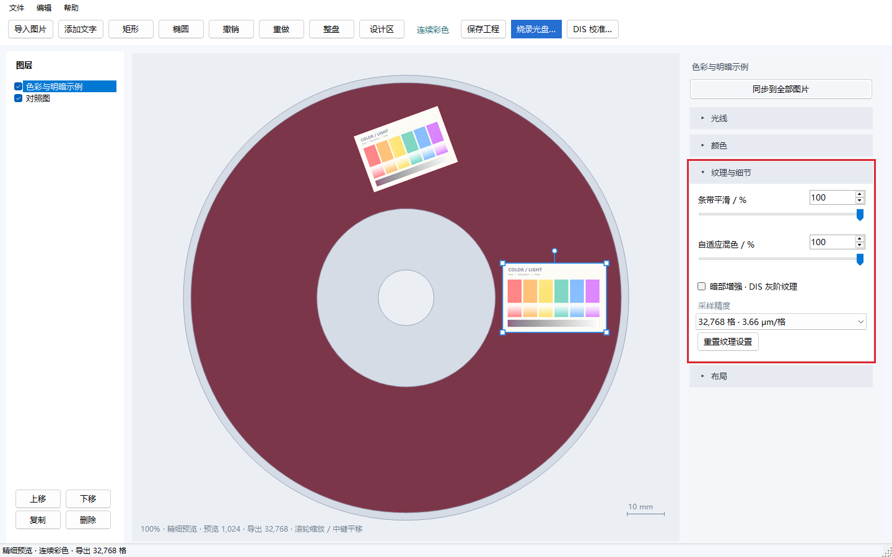

| 设置 | 做什么 | 怎么选 |
| --- | --- | --- |
| 条带平滑 | 平滑相邻盘面角度之间的纹理配方过渡，减轻沿盘面出现的条状颜色分界。 | **先用 100%**。需要比较过渡强弱时，复制一张图，将副本设为 50%。 |
| 自适应混色 | 把多种相近纹理分配到细密的小区域，用混合后的外观逼近中间色和渐变。 | **先用 100%**。想比较较少混色的效果时，可将副本设为 50%，重点看肤色、渐变和轮廓。 |
| 暗部增强 · DIS 灰阶纹理 | 在亮度低、色彩较弱的区域加入 DIS 灰阶纹理，增强黑色衣服、阴影和深色轮廓。 | 默认关闭。深色区域偏亮或偏彩时，可开启，再检查暗部细节。 |
| 采样精度 | 控制生成镜像时，软件读取原图的空间密度。 | 一般图片从 **32,768 格** 开始；细线、小字较多时，可用 **65,536 格** 对照。 |

**采样精度如何选择：**

| 档位 | 软件采样间距 | 建议用途 |
| --- | --- | --- |
| 32,768 | 约 3.66 μm / 格 | 日常绘图的起点。 |
| 65,536 | 约 1.83 μm / 格 | 细发丝、小字、精细轮廓的进一步对照。 |
| 131,072 / 262,144 | 约 0.92 / 0.46 μm / 格 | 高密度取样实验；额外清晰度收益尚未实测，生成镜像耗时更长。 |

“格”表示把 120 mm 宽的画布划分为对应数量的采样位置。窗口底部的 **预览** 数值用于交互显示，**导出** 数值用于生成镜像。

当前编码器通常沿轨道每约 **2.13 μm** 对一个可控数据字节取样（16 × 0.1333 μm）；同步码和纠错码区域会使部分取样间隔更大。相邻轨道的标称间距约 **0.74 μm**。更细的软件网格可减小边缘定位和取样误差，实际收益取决于图像、纹理和几何校准。**0.46 μm 是软件采样间距；实盘图像的有效分辨率尚未测定。** [编码实现](https://github.com/Neo-626/DiscColorStudio/blob/main/third_party/DiscImageStudio/DvdImageSolver/Solver/FastDispersionImageWriter.cs) · [DVD-R 规范，第 10.8、10.9、20 节](https://ecma-international.org/wp-content/uploads/ECMA-359_1st_edition_december_2004.pdf)

### 7. 做对照、同步设置，保存彩色工程

1. 想在一张盘上比较效果：选中图片，点击左侧 **复制**（或 **Ctrl+D**），把副本移到另一处，再单独调整副本。
2. 确定一套调整后，点击右栏上方的 **同步到全部图片**。当前图片的光线、整体与八色 HSL、纹理与采样设置会应用到所有图片，并用于后续导入的图片；各图的位置、尺寸、旋转和不透明度保持原值。
3. 点击 **保存工程**（或 **Ctrl+S**），保存为 **`.discolor`**。图片素材、图层排版、调整参数和导入的 DIS 几何校准都会保存进去。

**撤销 / 重做** 支持 Ctrl+Z / Ctrl+Y；整次同步也可以撤销。

### 8. 生成镜像并烧录，转动盘片查看效果

1. 将一张新的空白单层 DVD-R 放入光驱，点击顶部 **烧录光盘…**。
2. 在光驱下拉框中选择刻录机。刚放入盘片时，可以点 **刷新光驱** 更新介质信息。
3. 选择光驱提供的刻录速度。使用本项目已测试的 95058 盘片时，可从 **4×** 开始；自己的校准与正式刻录采用相同的速度，便于复现效果。
4. 点击 **选择…** 设置镜像保存位置，例如 `D:\DiscColorStudio\my-design.iso`。为单层 DVD 镜像准备约 **5 GB** 可用磁盘空间。
5. 点击 **烧录光盘**，程序会先生成 ISO，再写入光盘，完成后显示刻录结果。若想先保存镜像，点击旁边的 **生成 ISO**。

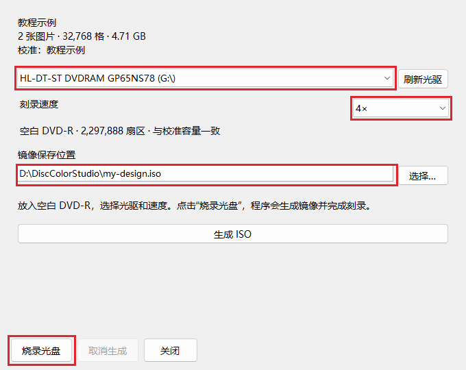

取出光盘，把数据面朝向白光 LED 灯和观察者。固定灯与观察位置，缓慢转动、轻微倾斜盘片，依次找到各张图颜色较好的姿态。项目首页的视频展示了这个寻找观看角度的过程。

**三个文件各有什么用：**

| 文件 | 来源与用途 |
| --- | --- |
| `.discproj` | DIS 保存的 DVD 绘图工程；在本程序开始设计时导入其中的几何校准。 |
| `.discolor` | 本程序保存的彩色设计工程；以后打开它继续排版和调色。 |
| `.iso` | 生成好的 DVD 数据镜像；用于写入光盘。 |

在 **帮助 → 使用方法** 中查看教程，也可直接打开便携包中的 **使用说明.html**（中文）或 **UserGuide.html**（英文）。

## Vibe coding 声明

本项目完全由 AI 完成。

## 从源码构建

需要 Windows x64 与 .NET 10 SDK。

```powershell
dotnet publish src/DiscColorStudio/DiscColorStudio.csproj -c Release -r win-x64 --self-contained true -o publish
```

运行所需色表随源码提供。

## 演示插画来源与声明

实盘照片和视频使用了以下作品作为图案，感谢各位创作者。页码从第 1 张开始计算。

| 作品 | 作者／发布者 | 演示使用的图片 |
| --- | --- | --- |
| [GF2 Klukai](https://www.pixiv.net/artworks/134992243) | [gcmsfromisland](https://www.pixiv.net/users/112251818) | 第 2 张（p1） |
| [AK-12](https://www.pixiv.net/artworks/133822252) | [BatonKhleba](https://www.pixiv.net/users/118918672) | 第 1 张（p0） |
| [HK416](https://www.pixiv.net/artworks/131999367) | [momostima](https://www.pixiv.net/users/89801761) | 唯一一张（p0） |
| [八奈見杏菜『地雷系美少女 八奈见酱』](https://www.pixiv.net/artworks/124941070) | [黑木kuro](https://www.pixiv.net/users/29258872) | 第 1 张（p0） |

以上插画用于展示 DVD-R 刻录与实盘显色效果，相关插画及角色权利归各自权利人。

**权利人联系与移除：** 如权利人认为演示照片、视频或其他展示涉及侵权，请通过 [项目 Issue](https://github.com/Neo-626/DiscColorStudio/issues/new) 联系，注明原作链接和涉及的展示位置。我们会及时核实并移除相关素材。

## 许可与来源

程序代码使用 GNU GPL v3，见 [LICENSE](LICENSE)。上游版本、修改范围与第三方许可见 [THIRD-PARTY-NOTICES.html](THIRD-PARTY-NOTICES.html)。分发程序时同时提供对应源码与许可。

演示照片和视频中的插画、角色属于各自权利人。
