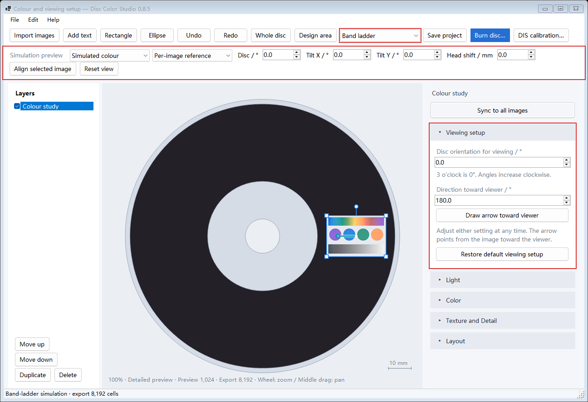

# Band ladder · v0.8.5

**English** | [简体中文](BandLadder.zh-CN.md)

**Band ladder trades color fidelity and brightness for a wider viewing-angle range.** Select **Band ladder** or **Measured colour** in the toolbar. New projects start in Band ladder mode; existing projects retain their saved method.

## Create a design

Import your calibrated DIS `.discproj` when starting a new project, then import and arrange your images. The [main guide](../README.md#usage-guide) covers calibration, image editing, saving, and DVD-R burning.

The screenshot uses a generated color chart. Red boxes mark the method selector, simulation controls, and viewing settings.

## Set how an image will be viewed

Select an image and expand **Viewing setup**. Both settings belong to that image and can be changed at any time, in any order.

| Setting | Meaning | How to choose |
| --- | --- | --- |
| **Disc orientation for viewing** | Clockwise rotation of the entire disc around its hub, relative to the design canvas. | The original 3 o’clock direction points right at 0°, down at 90°, left at 180°, and up at 270°. Enter the orientation in which you plan to view this image. |
| **Direction toward viewer** | Direction from the image toward the viewer at that disc orientation. | Right is 0°, down 90°, left 180°, and up 270°. Enter a value, or click **Draw arrow toward viewer** and drag inside the image. |

The canvas retains its layout orientation, so the arrow is transformed back into canvas coordinates. Changing disc orientation preserves the numeric viewer direction and rotates the canvas arrow accordingly. Dragging the arrow preserves disc orientation. Arrow length is just a drawing handle.

Release the mouse to update predicted color. Drag the arrow endpoint to adjust it again; Shift snaps to 15°, and Esc cancels the gesture. **Restore default viewing setup** places the image at the disc’s right side for observation, with the viewing point above the hub. In the example, the image is already at 3 o’clock: disc orientation 0°, viewer direction 180°.

Moving or resizing an image recalculates its recipe. **Layout → Rotation** rotates the artwork. **Sync to all images** copies image adjustments while each image retains its own viewing setup.

## Compare observation angles

The top **Simulation preview** row examines the encoded recipe while you adjust disc rotation, tilt, and head shift.

- **Per-image reference** shows each image at its own chosen viewing setup.
- **Shared disc pose** shows the disc under one common scene. **Align selected image** uses the selected image’s scene.
- **Simulated colour** shows the prediction; **Adjusted source** shows the image after its color adjustments.
- **Reset view** returns the simulation to the per-image reference.

Under **Texture and Detail**, **View balance** balances the central viewing point against nearby viewpoints. Lower values prioritize the central point. **Sampling precision** controls the image grid used for encoding.

## Save and burn

Save the `.discolor` project to retain both viewing settings. Select **Burn disc…**, choose the drive and a supported speed, and generate the ISO for a new blank single-layer DVD-R. The burn window also accepts an existing ISO for writing.

## How the band ladder works

The image is encoded with 30 recording periods, spanning 20.4T–8T, interleaved over a repeating 67-track schedule. Here T is one DVD channel-bit length. Different periods supply different wavelengths as the viewing direction changes. The program calculates their local responses and fits the red, green, and blue band proportions to the image. Spatial halftoning turns those proportions into writable DVD textures.

Spreading the available area across these periods broadens the viewing range, with lower brightness and color fidelity than the measured-color approach. Each image’s position and viewing setup affect the recipe. Preview and ISO generation use the same recipe calculation.
