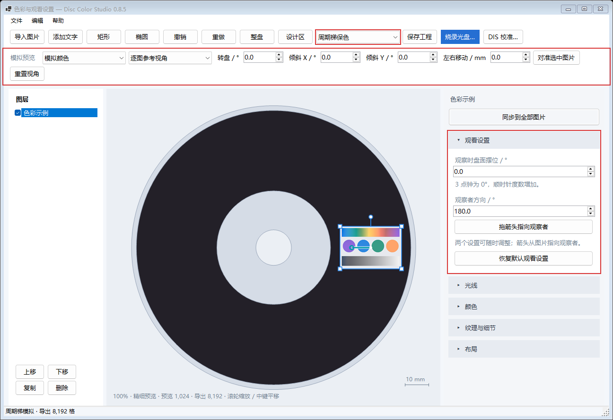

# 周期梯 · v0.8.5

[English](BandLadder.md) | **简体中文**

**周期梯以降低色彩还原度和亮度，换取更大的可视角度。** 在工具栏选择「周期梯保色」或「实测彩色」。新工程默认采用周期梯，已有工程保留保存时的方案。

## 创建设计

新建工程时导入 DIS 校准好的 `.discproj`，然后导入并排版图片。[主说明](../README.zh-CN.md#功能与使用)介绍了几何校准、图片编辑、保存和 DVD-R 烧录。

截图使用程序生成的色卡。红框分别标出了方案选择、模拟预览和观看设置。

## 设置图片的观看方式

选中图片，展开「观看设置」。两项参数都属于这张图片，可按任意顺序、随时调整。

| 设置 | 含义 | 怎么选择 |
| --- | --- | --- |
| **观察时盘面摆位** | 整张光盘相对于设计画布，绕盘心顺时针旋转的角度。 | 原来的 3 点钟方向在 0° 时朝右、90° 时朝下、180° 时朝左、270° 时朝上。填写观看这张图时准备使用的盘面摆位。 |
| **观察者方向** | 处于所设摆位时，从图片指向观察者的方位。 | 右为 0°、下为 90°、左为 180°、上为 270°。可以输入数值，或点击「拖箭头指向观察者」，在图片中拉出箭头。 |

画布保持排版方向，箭头会换算回画布坐标。调整盘面摆位时，观察者方向数值保持不变，画布箭头相应转动。拖动箭头时，盘面摆位保持不变。箭头长度只用于拖动操作。

松开鼠标更新预测颜色。拖箭头端点可继续调整；Shift 吸附到 15°，Esc 取消当前拖动。「恢复默认观看设置」采用图片转到盘面右侧、观察点位于盘心上方的参考状态。截图中的图片已在 3 点钟位置，对应盘面摆位 0°、观察者方向 180°。

移动或缩放图片后会重新计算配方。「布局 → 旋转」调整图片自身朝向。「同步到全部图片」同步图片调整，各图保留自己的观看设置。

## 比较不同观看角度

上方「模拟预览」用于查看固定配方在转盘、倾斜和左右移动时的表现。

- 「逐图参考视角」显示每张图片各自选定的观看状态。
- 整盘统一姿态使用同一个观看场景；「对准选中图片」把当前图片的场景用于整盘模拟。
- 「模拟颜色」显示预测效果；原图选项显示经过颜色调整的输入图片。
- 「重置视角」恢复逐图参考状态。

「纹理与细节」中的「视角平衡」调整中心观看位置与附近视角之间的权重。较低的值更重视中心位置。「采样精度」决定编码使用的图片网格。

## 保存与烧录

保存 `.discolor` 工程后，两项观看设置都会保存。点击「烧录光盘…」，选择光驱与支持的速度，生成 ISO 并写入新的空白单层 DVD-R。烧录窗口也可以选择已有 ISO 继续写入。

## 周期梯的原理

图像使用 20.4T–8T 的 30 种记录周期，在每 67 圈轨道中交替排列；T 表示 DVD 的一个通道位长度。观察方向变化时，不同周期提供不同波长的光。软件逐点计算它们的响应，拟合红、绿、蓝三个波段的比例，再通过细密的空间混排转成可写入 DVD 的纹理。

把面积分给这些周期，可以扩大可视角度，同时降低亮度和色彩还原度。每张图片的盘面位置和观看设置都会影响配方；预览与 ISO 生成共用这套计算。
